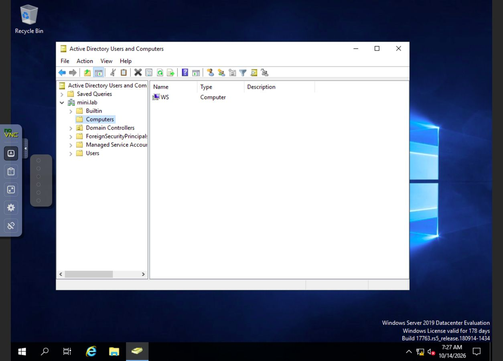
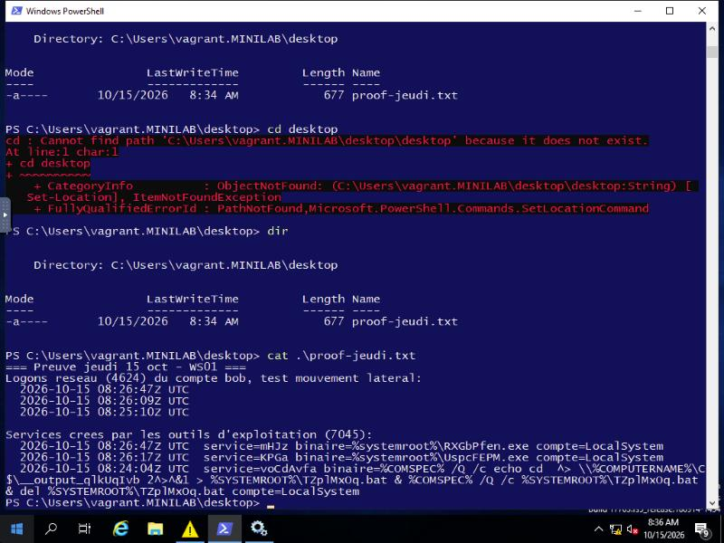

# GOAD Purple Team Lab

**Journal du projet, résultats et captures d’écran — du 12 au 16 octobre 2026.**

Dernière mise à jour : **15 octobre 2026**.

Projet personnel de test d’intrusion sur un environnement Active Directory
volontairement vulnérable, basé sur [GOAD](https://github.com/Orange-Cyberdefense/GOAD).
Wazuh permet d’observer les traces et de vérifier la détection des tests.
Ce projet sert aussi de rendu PPE pour le cours *Techniques de gestion de projets*
(CFC 306, Projet 5).

## Sommaire

- [Avancement](#avancement)
- [Environnement et planning](#environnement-et-planning)
- [Journal et captures d’écran](#journal-et-captures-décran)
  - [Lundi 12 octobre — préparation](#lundi-12-octobre--préparation)
  - [Mardi 13 octobre — installation et validation](#mardi-13-octobre--installation-et-validation)
  - [Mercredi 14 octobre — premiers tests](#mercredi-14-octobre--premiers-tests)
  - [Jeudi 15 octobre — mouvement latéral et DCSync](#jeudi-15-octobre--mouvement-latéral-et-dcsync)
  - [Vendredi 16 octobre — à compléter](#vendredi-16-octobre--à-compléter)
- [Difficultés et décisions](#difficultés-et-décisions)
- [Prochaines étapes](#prochaines-étapes)
- [Documents utiles et sources](#documents-utiles-et-sources)

## Avancement

| Étape | État au 15 octobre |
| --- | --- |
| Installer le lab et son réseau isolé | Terminé et vérifié |
| Installer Wazuh et recevoir les événements des deux machines | Terminé et vérifié |
| Réaliser le test d’intrusion | Mouvement latéral et compromission du domaine obtenus |
| Vérifier la détection de chaque technique | Mouvement latéral et DCSync corrélés dans Wazuh ; écart de détection documenté sur le 4688 |
| Vérifier la reconstruction complète du lab | À faire |
| Rédiger le rapport, le guide de détection et le bilan | À faire |
| Publier les livrables sur le portfolio | À faire |

**Le compte `bob`, compromis mercredi via une description LDAP lisible, a permis une
exécution de code en LocalSystem sur WS01 (mouvement latéral).** Jeudi, un DCSync
avec le compte `alice` (Domain Admins, identifiants du scénario) a extrait le hash
et les clés Kerberos du compte `Administrator` : **compromission du domaine obtenue**.

## Environnement et planning

| Élément | Configuration retenue |
| --- | --- |
| Hôte | Poste personnel sous Pop!_OS, 16 Go de RAM |
| Virtualisation | KVM/QEMU et libvirt ; adaptation locale de GOAD MINILAB |
| DC01 | Windows Server 2019, nom Windows `DC`, domaine `mini.lab`, `192.168.56.30` |
| WS01 | Windows Server 2019, nom Windows `WS`, membre du domaine, `192.168.56.31` |
| Ressources Windows | 2 vCPU et 2 Gio de RAM par VM |
| Outils de test | Sur l’hôte pour économiser la mémoire |
| Supervision | Manager Wazuh 4.14.0 en conteneur, limité à 1 Gio / 1 CPU, deux agents Windows |
| Interface Wazuh | Sans indexeur ni tableau de bord ; contrôle des événements et des agents par les outils locaux |
| Réseaux | `goad-purple-lab` et `goad-purple-mgmt`, isolés après installation |

Budget prévisionnel : **20 heures au total, environ 4 heures par jour**.
Le temps humain réellement consacré au projet reste à consigner ; les attentes
de téléchargement et d’installation ne sont pas comptées comme du travail mesuré.

| Jour | Prévision et situation |
| --- | --- |
| Lundi 12 | Préparation du lab commencée |
| Mardi 13 | Installation terminée et validée ; la préparation a débordé d’un jour |
| Mercredi 14 | Reconnaissance, premier constat et captures directes |
| Jeudi 15 | Mouvement latéral (SYSTEM sur WS01) et DCSync réussis, détections corrélées |
| Vendredi 16 | Finalisation du rapport, bilan et publication, à réaliser |

## Journal et captures d’écran

Toutes les images publiées figurent ci-dessous, dans le journal du jour concerné.
Les fichiers sont rangés dans [`screenshots/`](./screenshots/), par date.

**Dates des captures :** les quatre captures directes des fenêtres Windows ont été
prises le **14 octobre entre 09:27 et 09:31 à Zurich** (07:27–07:31 UTC).
Pour les **12 et 13**, aucune capture originale des fenêtres n’a été conservée.
Le suivi écrit de ces journées est présenté ci-dessous.

### Lundi 12 octobre — préparation

- Préparation des dépendances et des images Windows, versions épinglées et vérifiées.
- Normalisation de la première image Windows pour permettre le provisionnement WinRM.
- Configuration du contrôleur et du domaine `mini.lab` à partir du scénario GOAD.
- Installation du manager Wazuh et de l’agent sur DC01.
- Réception d’événements réels : connexion réseau réussie (4624 / règle 100101)
  et échec volontaire avec un compte inexistant (4625 / règle 100100).

**Résultat :** la collecte sur DC01 fonctionne. Ces tests de préparation ne
prouvent aucune compromission ; la détection DCSync reste à tester.

### Mardi 13 octobre — installation et validation

- Adaptation de la découverte réseau GOAD : les interfaces sont calculées par hôte.
- Remplacement de l’image Windows 10 expirée par un serveur membre Windows Server 2019.
- Généralisation de WS01 avec Sysprep pour lui donner une identité Windows distincte,
  puis restauration du réseau privé et suppression de la tâche temporaire utilisée.
- Jonction de WS01 au domaine et installation de son agent Wazuh.
- Isolation des deux réseaux et publication des scripts et des corrections sur GitHub.
- Correction du démarrage : DC01 est lancé avant WS01 pour faciliter la découverte du domaine.

**Contrôles du 13 octobre vers 09:41 à Zurich (07:41 UTC) :**

| Contrôle | Résultat observé |
| --- | --- |
| DC01 | `DC`, domaine `mini.lab` ; DNS, Kerberos, LDAP, SMB et WinRM accessibles |
| WS01 | `WS`, domaine `mini.lab` ; SMB et WinRM accessibles |
| Relation d’approbation WS01 → DC01 | `Test-ComputerSecureChannel : True` ; `nltest : NERR_Success` |
| Agents | `dc` (001) et `ws` (002) actifs ; service Wazuh démarré sur les deux hôtes |
| Collecte DC01 | Événement 4624 / règle 100101 reçu à 07:41:14.582 UTC |
| Collecte WS01 | Événement 4624 / règle 100101 reçu à 07:41:15.531 UTC |
| Isolation | Aucun élément `forward`, relais DNS désactivé sur les deux réseaux |
| Windows | Server 2019 sur les deux VM ; évaluations actives lors du contrôle |

Les connexions ci-dessus proviennent de l’administration de validation.
Des événements 4662 / règle 100102 apparaissent pendant le provisionnement :
**ils ne prouvent pas une attaque DCSync**.

### Mercredi 14 octobre — premiers tests

**Objectif :** repérer les services du lab et réaliser un premier test avec une
trace Wazuh correspondante. Les tests concernent uniquement DC01 et WS01.

1. Redémarrage des réseaux, du manager Wazuh, de DC01 puis de WS01.
2. Contrôle du domaine, de la relation d’approbation et des agents.
3. Scan de douze ports TCP sur chaque machine.
4. Lecture LDAP avec le compte `dave`, fourni par le scénario GOAD.
5. Une connexion SMB comme `bob`, avec le mot de passe découvert dans sa description.
6. Recherche et corrélation de l’événement de connexion côté Wazuh.

**Il s’agit d’un exercice guidé : le compte initial est connu grâce au scénario.**
Les mots de passe et les journaux bruts restent hors du dépôt public.

#### Résultats des premiers tests

##### Les deux rôles du lab sont visibles

| Machine | Rôle | Services ouverts parmi les ports testés |
| --- | --- | --- |
| DC01 | Serveur central du domaine | DNS, Kerberos, annuaire LDAP, partage SMB, administration Windows et bureau à distance |
| WS01 | Serveur membre du domaine | Partage SMB, administration Windows et bureau à distance |

Le scan est limité aux ports 53, 88, 135, 139, 389, 445, 464, 636, 3268, 3269,
3389 et 5985. Il ne constitue pas un inventaire exhaustif de tous les ports.
La cartographie BloodHound n'a pas encore été réalisée.

##### Une première faiblesse est confirmée

Le compte `dave` peut lire la description du compte `bob`. Cette description
contient le mot de passe de `bob` en clair. Une connexion SMB comme `bob` a
ensuite réussi sur DC01 avec cette valeur, sans devinette ni essai de dictionnaire.
Le mot de passe reste masqué et n'est pas publié.

**Conséquence démontrée :** un utilisateur du domaine peut récupérer un autre
compte à partir d'un renseignement lisible dans l'annuaire.

**Correction proposée :** retirer les mots de passe des descriptions, changer
le mot de passe exposé et vérifier les droits accordés au compte concerné.
Le lab reste volontairement vulnérable pendant l'exercice ; cette correction
n'a pas été appliquée aux machines de test.

La lecture LDAP montre aussi `bob` dans `wsadmin`, ainsi que `alice` et `carol`
dans `Domain Admins`. Ces appartenances ne prouvent pas encore une exécution
sur WS01 ni une compromission du domaine.

##### Wazuh a enregistré la connexion

| Champ | Valeur observée |
| --- | --- |
| Heure de réception par Wazuh | 14 octobre 2026, 08:45:11 à Zurich (06:45:11 UTC) |
| Machine | DC01, agent dc |
| Compte | bob |
| Événement Windows | 4624, ouverture de session réseau, type 3 |
| Règle Wazuh | 100101 |
| Source | Hôte de test du lab, 192.168.56.1 |

Le test s'est déroulé à 06:45:10–06:45:11 UTC ; l'alerte a été reçue à
06:45:11.965 UTC. La concordance porte sur l'heure, le compte, la source et la machine.
La règle détecte une connexion réseau ; elle ne démontre pas à elle seule le vol
du mot de passe ni la lecture de sa description LDAP.


#### Capture directe 1 — WS enregistré dans Active Directory

**DC01 · Active Directory Users and Computers · 14 octobre, 09:27 à Zurich.**
Le conteneur `Computers` de `mini.lab` contient l’objet `WS`. Cette vue montre
son enregistrement dans l’annuaire ; elle ne teste pas la relation d’approbation.



#### Capture directe 2 — contrôleur de domaine

**DC01 · même console · 14 octobre, 09:30 à Zurich.**
Le conteneur `Domain Controllers` contient `DC`, avec `GC` pour catalogue global.


#### Capture directe 3 — domaine et service Wazuh dans PowerShell

**WS01 · Windows PowerShell · 14 octobre, 09:30 à Zurich.**
La session `MINILAB\vagrant` affiche le nom `WS`, le domaine `mini.lab`,
`PartOfDomain : True` et le service `WazuhSvc` à l’état `Running`.


#### Capture directe 4 — agent Wazuh dans les services Windows

**WS01 · Services Windows · 14 octobre, 09:31 à Zurich.**
Le service sélectionné affiche `Wazuh`, l’état `Running` et le démarrage `Automatic`.
Ces deux captures de service établissent son état local ; la réception côté
manager est documentée par les événements corrélés ci-dessus.


Ces quatre images sont des captures sans retouche des consoles réelles des VM,
consultées via noVNC. L’horloge Windows en bas des images est en UTC.
Elles montrent les vérifications du 14, sans prouver à elles seules les attaques.

#### Correction des horloges et traçabilité

Un décalage d’environ **sept heures d’avance** des horloges Windows a été
identifié. Les heures de test sur l’hôte et de réception Wazuh sont distinguées
des heures internes Windows. Le test initial utilisait NTLM ; aucun succès
Kerberos n’est revendiqué.

Les deux VM ont été remises à l’heure UTC. Une nouvelle lecture vers 06:59 UTC
a mesuré environ 1,55 s d’écart pour DC01 et 0,52 s pour WS01. Le domaine et
les services Wazuh ont également été contrôlés. Les traces initiales sont conservées
avec leurs heures d’origine.

### Jeudi 15 octobre — mouvement latéral et DCSync

**Objectif :** vérifier si les identifiants de `bob` (trouvés mercredi) permettent une
réelle exécution de code sur WS01, puis tenter la compromission du domaine par DCSync
avec un compte Domain Admins du scénario, en corrélant chaque étape côté Wazuh.

#### Mouvement latéral

1. Redécouverte du mot de passe de `bob` par lecture LDAP (même technique que mercredi).
2. `wmiexec.py` échoue côté client : la connexion DCOM reste bloquée après la sélection
   du port RPC dynamique (49667), bien que ce port soit ouvert. Cause non confirmée.
3. `smbexec.py` puis `psexec.py` (deux tentatives) : le partage `ADMIN$` est accessible
   en écriture avec les identifiants de `bob`, un binaire est déposé, un service Windows
   est créé puis démarré. **Les trois services tournent en `LocalSystem`** — démontrant
   une exécution de code avec les plus hauts privilèges sur WS01, même si la sortie de
   la commande (`whoami`) n'a pas pu être récupérée côté client (blocage sur le canal de
   sortie, sans incidence sur le résultat de l'attaque).
4. Contrôle après coup : les trois services se sont supprimés automatiquement
   (comportement normal des outils Impacket) ; aucun artefact résiduel sur WS01.

**Observation annexe :** des connexions réseau répétées du compte `carol` (Domain
Admins) depuis DC01 vers WS01 ont été repérées pendant le test, toutes les ~30
secondes. Vérification faite (`query session`) : aucune session interactive, logon
de type réseau uniquement — il s'agit d'une activité d'arrière-plan du lab GOAD,
sans lien avec nos tests.

#### Compromission du domaine (DCSync)

Avec les identifiants d'`alice` (Domain Admins, fournis par le scénario GOAD — test
guidé, comme pour `dave` mercredi) :

```
secretsdump.py -just-dc-user administrator mini.lab/alice:***@192.168.56.30
```

**Résultat :** extraction réussie du hash NTLM et des clés Kerberos (AES256, AES128,
DES) du compte `Administrator`. Réplication volontairement limitée à un seul compte
(`-just-dc-user administrator`), conformément au cahier des charges. Secrets non
publiés, conservés uniquement en local.

#### Détection côté Wazuh

| Technique | Règle déclenchée | Résultat |
| --- | --- | --- |
| Logons réseau de `bob` (4 tentatives) | 100101 (custom, niveau 6) | 28 événements 4624 corrélés, agent `ws`, source 192.168.56.1 |
| Dépôt de service via un partage admin (`smbexec`/`psexec`) | **92650** (règle Wazuh **native**, niveau **12**) | 2 alertes : *"New Windows Service Created to start from windows root path. Suspicious event as the binary may have been dropped using Windows Admin Shares."* — détection plus sévère que toute règle custom du projet |
| Création de process (4688) pendant les tests | 67027 (règle générique par défaut, niveau 3) | 729 occurrences, mais sans corrélation au compte ni au contexte — **écart de détection documenté** : collecté et techniquement alerté, mais noyé dans le bruit, inexploitable pour un triage |
| DCSync (droits de réplication AD) | 100102 (custom, niveau 10) | 3 événements 4662, compte `alice`, GUID `1131f6aa`/`1131f6ad` (DS-Replication-Get-Changes / -All), horodatage concordant à la seconde près avec le test |

**Point marquant pour le rapport final :** la détection la plus sévère du jour (niveau 12)
vient d'une règle Wazuh **par défaut**, pas d'une règle écrite pour ce projet — un bon
argument pour la partie « valeur du ruleset de base » du guide de détection.



**WS01 · console PowerShell · 15 octobre, 08:36 UTC.** Capture du contenu d'un
fichier de preuve généré depuis les journaux Windows, affichant les horodatages
des logons de `bob` et des trois créations de service en `LocalSystem`.

### Vendredi 16 octobre — à compléter

Séance à réaliser : finaliser le rapport, le guide de détection, le bilan et le
retour d’expérience ; vérifier les objectifs effectivement atteints et publier
les livrables. Les résultats et les captures seront ajoutés ici.

## Difficultés et décisions

| Difficulté | Décision et résultat |
| --- | --- |
| GOAD à adapter pour KVM/libvirt | Adaptation locale de MINILAB à deux machines pour respecter les ressources disponibles |
| Image Windows 10 expirée, arrêts automatiques | WS01 recréé sous Windows Server 2019 |
| Mauvaise découverte de l’interface réseau | Calcul des interfaces par hôte au lieu d’un résultat partagé avec `run_once` |
| Identité Windows identique entre les clones | Généralisation de WS01 avec Sysprep, puis jonction au domaine |
| Découverte du domaine mal initialisée au démarrage | Relance de la découverte sur WS01 ; démarrage de DC01 avant WS01 et validation explicite |
| Horloges Windows décalées | Correction UTC ; distinction entre heure du test, heure Windows et réception Wazuh |
| Absence de captures originales des 12 et 13 | Suivi écrit conservé ; captures techniques disponibles à partir du 14 |
| Préparation terminée le 13 au lieu du 12 | Prioriser un scénario court, documenté et corrélé à Wazuh avant le 16 |
| `wmiexec` bloqué sur l'appel DCOM malgré un port RPC ouvert | Repli sur `smbexec`/`psexec` (SMB uniquement) ; la création et le démarrage réussis de services en LocalSystem suffisent à prouver l'exécution de code, même sans récupérer la sortie de la commande |
| Sortie des commandes distantes non récupérable côté client (blocage sur le canal de sortie) | Preuve basée sur les journaux Windows et Wazuh plutôt que sur la sortie texte de l'outil ; résultat non affecté |

## Prochaines étapes

- [x] Installer et vérifier le lab isolé.
- [x] Recevoir de vrais événements Wazuh depuis les deux machines.
- [x] Réaliser une première reconnaissance des services.
- [x] Vérifier une première faiblesse et corréler la connexion dans Wazuh.
- [x] Publier le suivi et les quatre captures techniques dans cette documentation.
- [x] Vérifier les privilèges de `bob` sur WS01 : exécution de code en LocalSystem confirmée (mouvement latéral).
- [x] Obtenir la compromission du domaine (DCSync avec `alice`, réplication limitée à `administrator`).
- [x] Relier chaque technique aux traces ou alertes, y compris un écart de détection documenté (4688 collecté mais non corrélé).
- [ ] Compléter la cartographie du domaine (BloodHound), si le temps le permet.
- [ ] Vérifier la reconstruction complète depuis zéro ; aucun délai de 15 minutes n’est validé.
- [ ] Rédiger le rapport de pentest et le guide de détection.
- [ ] Compléter les rapports d’avancement, le bilan et le retour d’expérience.
- [ ] Publier les livrables sur le portfolio.

**À consigner par le porteur du projet :** temps réellement travaillé chaque jour,
explication des résultats et des limites, décisions prises et bilan personnel.

Pour chaque prochaine étape importante, ajouter ici une capture prise pendant
l’action, sa date, la machine, l’outil et le résultat observé. Les erreurs,
corrections et résultats négatifs font aussi partie du suivi.

## Documents utiles et sources

Le suivi et toutes les captures sont regroupés sur cette page. Les documents
suivants servent à cadrer le projet ou à utiliser le lab :

- [Cahier des charges](./cahier-des-charges.md) : objectifs, périmètre, budget et grille d’évaluation.
- [Guide d’installation et commandes](./kvm/README.md) : exploitation technique du lab.
- [Scénario de test](./kvm/SCENARIO.md) : techniques prévues et détections attendues.

### Reproduction et fichiers sources

Le script [`initial-enumeration.py`](./kvm/scripts/initial-enumeration.py) reproduit
la lecture LDAP et l’unique connexion SMB. Il lit le compte de départ dans la
configuration du scénario GOAD, sans afficher ni exporter le mot de passe découvert.
La dépendance `pycryptodome==3.24.1` fournit le module `Crypto` utilisé pour NTLM
([documentation officielle](https://www.pycryptodome.org/src/installation)).

Les résultats Nmap, les horodatages et les exports détaillés de cette séance
restent localement dans `kvm/logs/2026-10-14/`, exclus de Git. Les validations
locales utilisent aussi `health.json`, `domain-validation.json` et
`alert-evidence.json`. Les secrets d’enrôlement, images de VM, mots de passe et
journaux bruts ne sont pas publiés. Les métadonnées d’alertes sont exportées par
une sélection explicite de champs.

La séance du 15 octobre (mouvement latéral et DCSync) suit la même logique :
détails et horodatages dans `kvm/logs/2026-10-15/jeudi-synthese.json`, exclus de
Git. Les hash et clés extraits par le DCSync ne sont conservés que localement.

### Dates et intégrité des captures

- [Manifeste des quatre captures directes du 14](./screenshots/2026-10-14/manifest-directes.json) :
  machine, logiciel, heure UTC et empreinte SHA-256.
- [Manifeste de la capture du 15](./screenshots/2026-10-15/manifest-directes.json) :
  mouvement latéral sur WS01.

Les originaux des traces sont figés dans les archives locales. Une empreinte
permet de vérifier l’intégrité d’un fichier ; elle ne certifie pas sa date.
