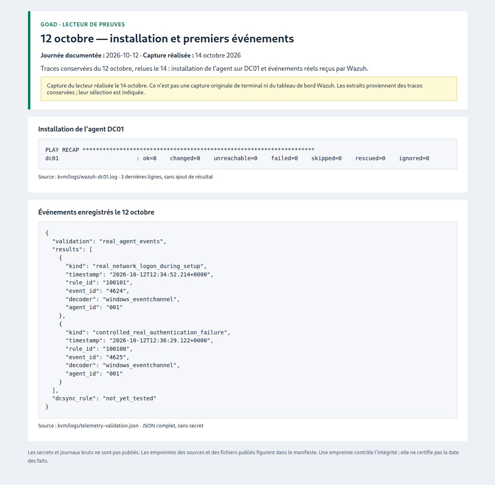

# Preuves du 2026-10-12

[← Toutes les journées](../README.md) · [Suivi du projet](../../../SUIVI.md)

**Capture du lecteur réalisée le 14 octobre à partir des traces conservées du 2026-10-12. Aucune capture originale de cette journée n’est disponible.**

## 12 octobre — installation et premiers événements

[Lire l’extrait texte](./12-collecte-wazuh.txt) · [Ouvrir l’image](./12-collecte-wazuh.jpg)

