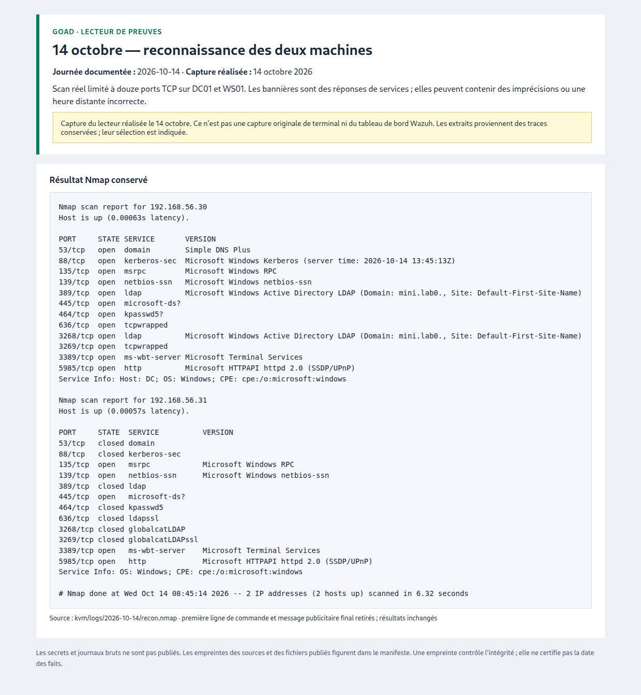
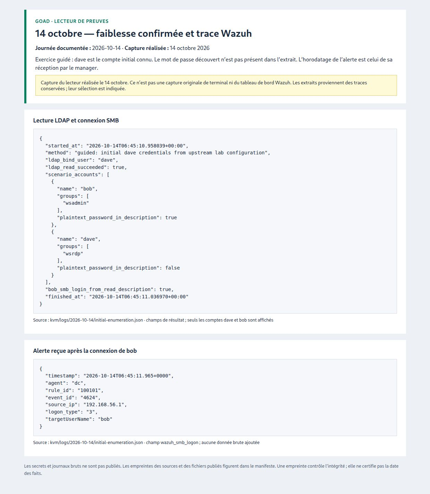
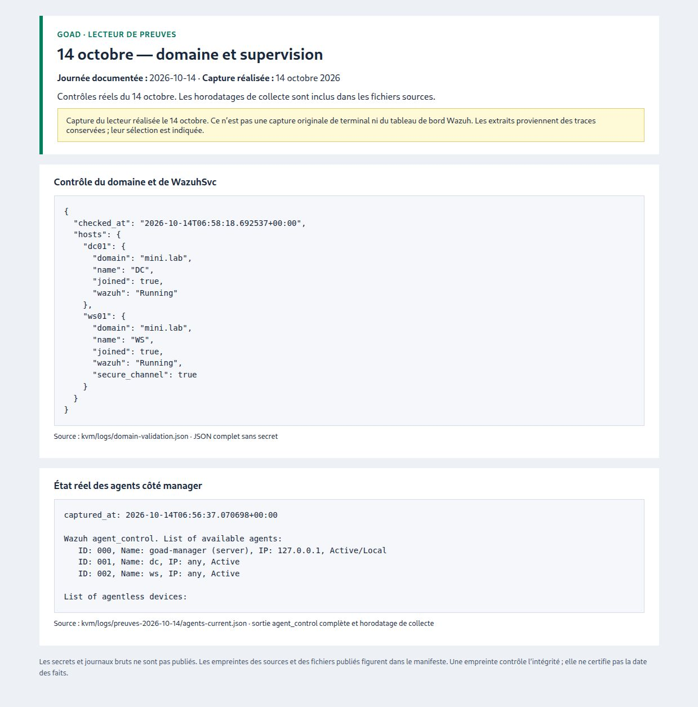
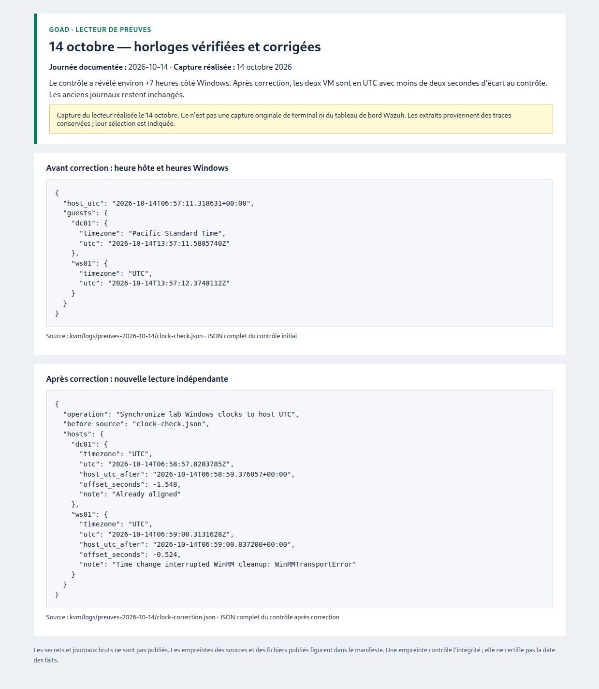

# Preuves du 2026-10-14

[← Toutes les journées](../README.md) · [Suivi du projet](../../../SUIVI.md)

## Fenêtres réelles des VM

**[Voir les quatre captures directes : Active Directory, PowerShell et service Wazuh](./captures-directes/README.md)**

Ces captures ont été réalisées pendant les vérifications du 14 octobre.

## Résultats conservés, présentés dans un lecteur

Les quatre images suivantes montrent la lecture des traces du même jour.
Elles sont distinctes des captures directes des VM liées ci-dessus.

## 14 octobre — reconnaissance des deux machines

[Lire l’extrait texte](./14-reconnaissance.txt) · [Ouvrir l’image](./14-reconnaissance.jpg)

## 14 octobre — faiblesse confirmée et trace Wazuh

[Lire l’extrait texte](./14-compte-bob-et-alerte.txt) · [Ouvrir l’image](./14-compte-bob-et-alerte.jpg)

## 14 octobre — domaine et supervision

[Lire l’extrait texte](./14-domaine-et-agents.txt) · [Ouvrir l’image](./14-domaine-et-agents.jpg)

## 14 octobre — horloges vérifiées et corrigées

[Lire l’extrait texte](./14-horloges-avant-apres.txt) · [Ouvrir l’image](./14-horloges-avant-apres.jpg)

