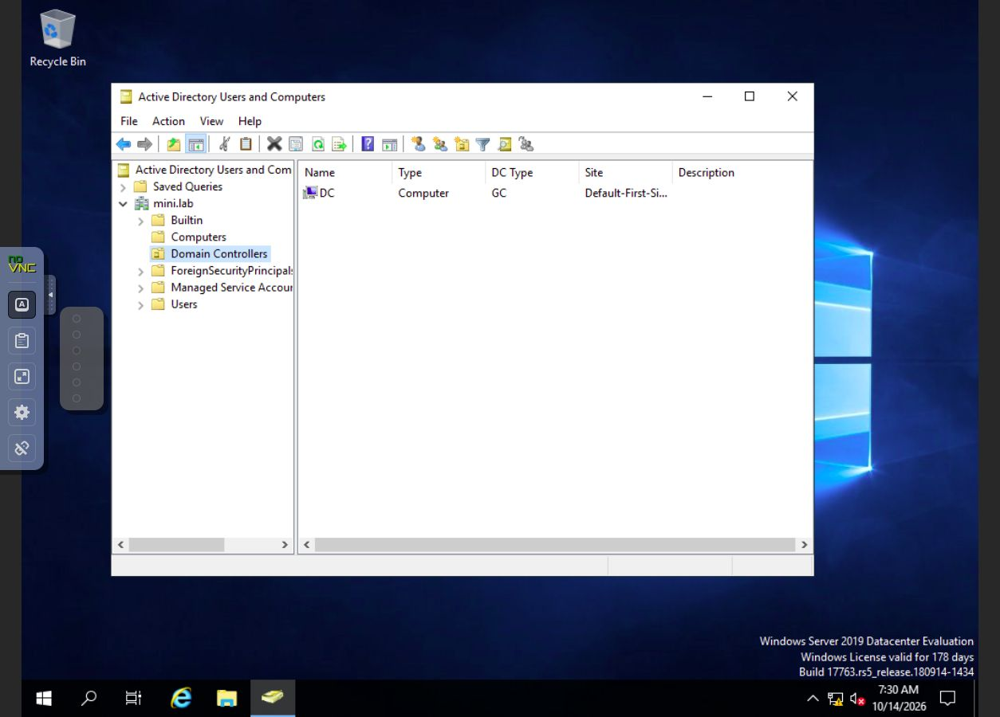
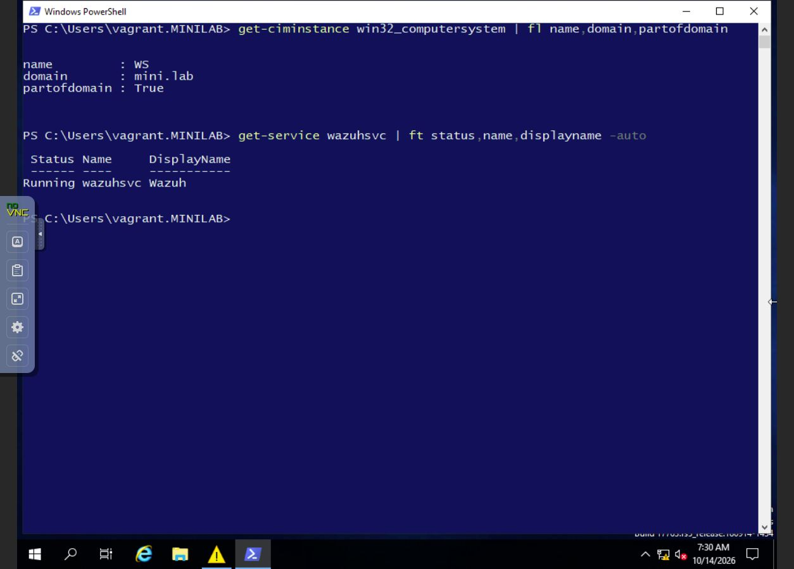
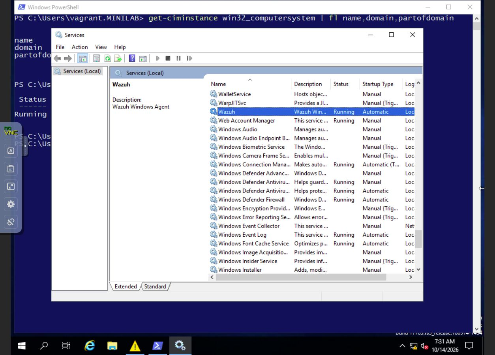

# Captures directes des VM — mercredi 14 octobre 2026

[← Preuves par journée](../../README.md) · [Compte rendu du mercredi](../../../seance-2026-10-14.md)

Ces quatre images montrent **les fenêtres réellement ouvertes dans les VM** :
console Active Directory, PowerShell et gestionnaire des services Windows.
Les contrôles ont été refaits le **14 octobre, entre 09:27 et 09:31, heure de Zurich**
(07:27–07:31 UTC). L’horloge Windows affichée en bas des images est en UTC.

Les consoles ont été consultées avec noVNC, depuis l’hôte. Les images sont
publiées sans retouche. Les noms libvirt `DC01` / `WS01` correspondent aux noms
Windows `DC` / `WS`. Le compte de session est `vagrant` ; PowerShell sur WS
utilise le compte de domaine `MINILAB\vagrant`.

## 1. Le serveur membre apparaît dans Active Directory

**Machine : DC01. Logiciel : Active Directory Users and Computers.**

Le conteneur `Computers` du domaine `mini.lab` contient l’objet ordinateur `WS`.
Cela montre son enregistrement dans l’annuaire ; cette seule vue ne teste pas
la relation d’approbation.

## 2. Le contrôleur de domaine est visible

**Machine : DC01. Même console d’administration.**

Le conteneur `Domain Controllers` contient `DC`, avec le rôle de catalogue global
indiqué par `GC`.

## 3. Windows confirme le domaine et le service Wazuh

**Machine : WS01. Logiciel : Windows PowerShell.**

La première commande retourne `WS`, `mini.lab` et `PartOfDomain : True`.
La seconde montre le service `WazuhSvc` dans l’état `Running`.
Ce contrôle établit l’état local du service ; la réception des événements côté
serveur est documentée séparément dans le compte rendu.

## 4. Le service Wazuh dans l’interface Windows

**Machine : WS01. Logiciel : Services Windows.**

La ligne sélectionnée affiche `Wazuh`, l’état `Running` et le démarrage
`Automatic`. La description indique `Wazuh Windows Agent`.

## Dates et portée des preuves

Il s’agit de vérifications réalisées le 14 octobre. Ces captures ne sont pas
présentées comme des captures prises les 12 ou 13, ni comme la preuve d’une
attaque ou d’une compromission du domaine. Aucune capture originale des
fenêtres des 12 et 13 n’a été conservée.

Le [manifeste](./manifest.json) indique l’heure UTC de chaque capture et son
empreinte SHA-256. Les empreintes permettent de vérifier les fichiers, pas de
certifier leur date. Aucun mot de passe ni clé d’agent n’est visible.
